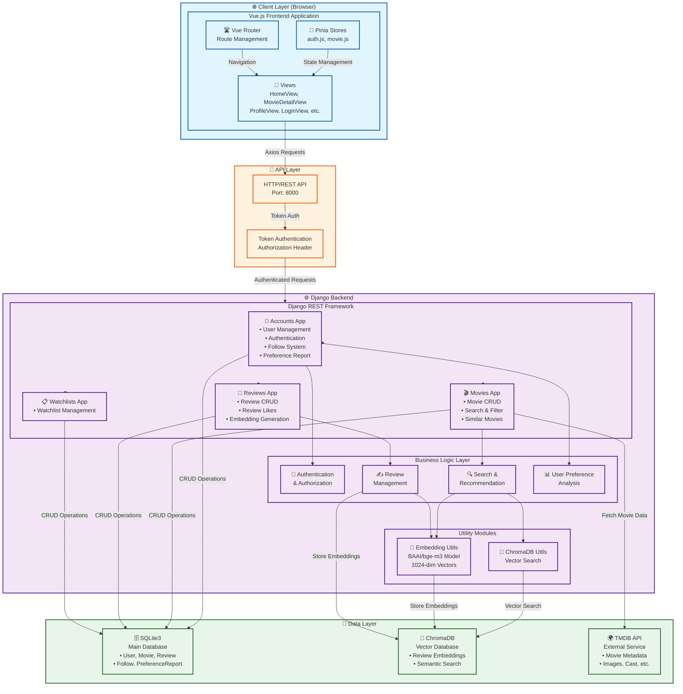
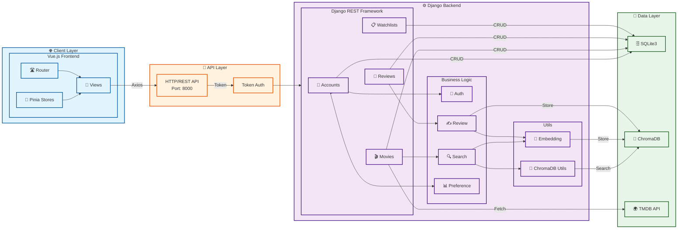
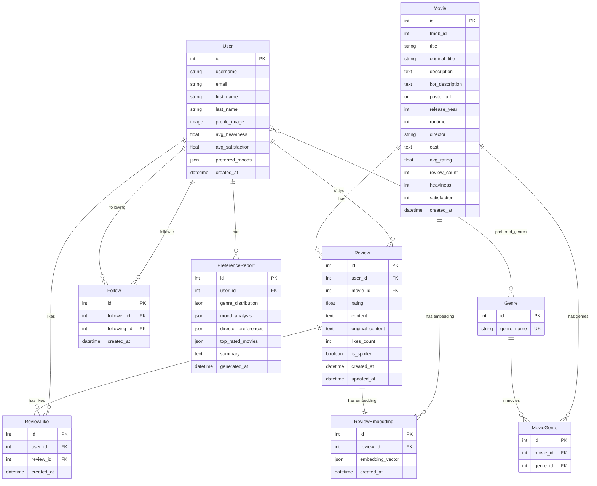
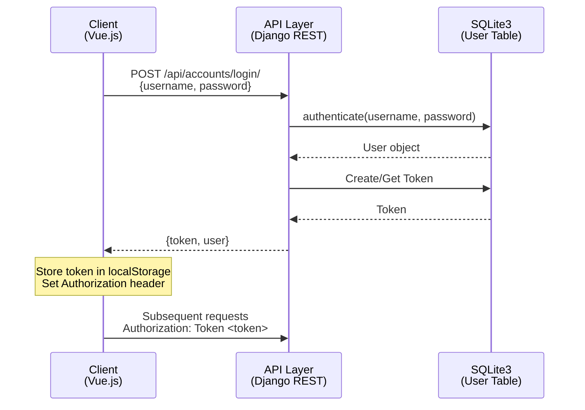
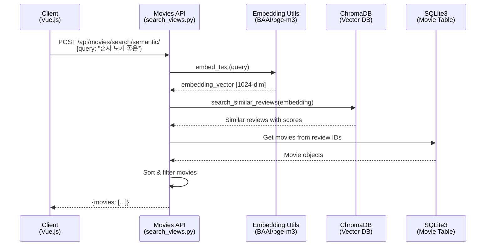
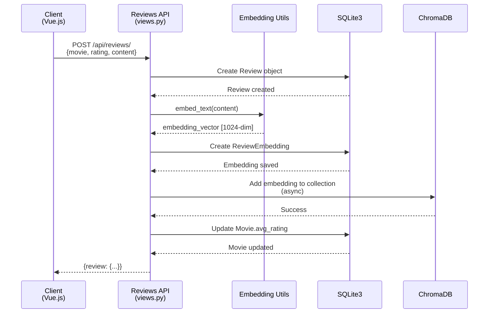
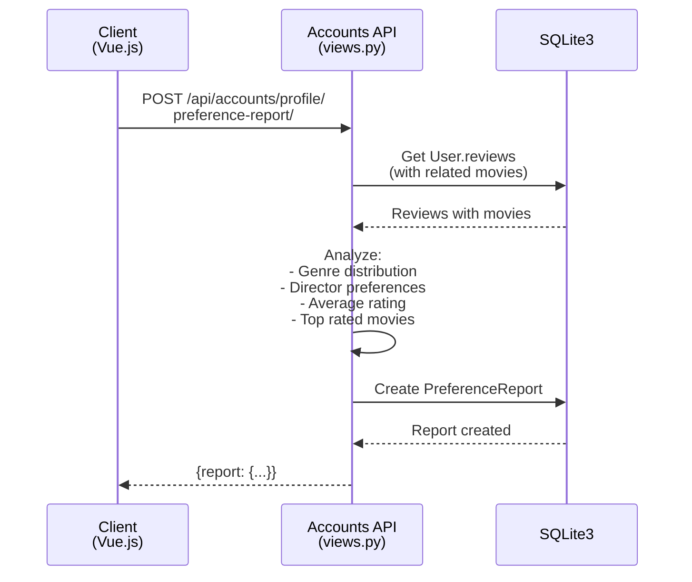

# 프로젝트 아키텍처 문서

## 📋 목차
1. [프로젝트 개요](#프로젝트-개요)
2. [기술 스택](#기술-스택)
3. [시스템 아키텍처](#시스템-아키텍처)
4. [백엔드 아키텍처](#백엔드-아키텍처)
5. [프론트엔드 아키텍처](#프론트엔드-아키텍처)
6. [데이터베이스 스키마](#데이터베이스-스키마)
7. [API 엔드포인트](#api-엔드포인트)
8. [데이터 흐름](#데이터-흐름)
9. [주요 기능](#주요-기능)

---

## 프로젝트 개요

영화 추천 및 리뷰 플랫폼으로, 자연어 검색 기반의 영화 추천 시스템과 개인화된 취향 분석 기능을 제공합니다.

### 핵심 기능
- 🎬 자연어 기반 영화 검색 및 추천
- 📝 영화 리뷰 작성 및 관리
- 👥 사용자 팔로우/팔로워 시스템
- 📊 개인 취향 리포트 생성
- 🔍 시맨틱 검색 (ChromaDB + 임베딩)

---

## 기술 스택

### Backend
- **Framework**: Django 5.2.9
- **API**: Django REST Framework 3.16.1
- **Database**: SQLite3 (개발), PostgreSQL (프로덕션 준비)
- **Authentication**: Token Authentication
- **Vector DB**: ChromaDB 1.4.0
- **ML/AI**: 
  - sentence-transformers 5.2.0
  - BAAI/bge-m3 (임베딩 모델)
  - PyTorch 2.9.1

### Frontend
- **Framework**: Vue.js 3
- **State Management**: Pinia
- **Routing**: Vue Router
- **HTTP Client**: Axios
- **Build Tool**: Vite

### External APIs
- **TMDB API**: 영화 데이터 수집

---

## 시스템 아키텍처

### Mermaid 다이어그램 (세로 방향)



### Mermaid 다이어그램 (가로 방향)



### 아키텍처 설명

위 다이어그램은 다음과 같은 계층 구조를 보여줍니다:

1. **Client Layer**: Vue.js 기반 프론트엔드 애플리케이션
2. **API Layer**: HTTP/REST API 및 인증 처리
3. **Backend Layer**: Django REST Framework 및 비즈니스 로직
4. **Data Layer**: 데이터 저장소 (SQLite3, ChromaDB, TMDB API)

---

## 백엔드 아키텍처

### Django 앱 구조

```
django-project/
├── accounts/          # 사용자 관리 앱
│   ├── models.py     # User, Follow, PreferenceReport
│   ├── views.py      # 인증, 프로필, 팔로우 API
│   ├── serializers.py
│   └── urls.py
│
├── movies/           # 영화 관리 앱
│   ├── models.py     # Movie, Genre, MovieGenre
│   ├── views.py      # 영화 목록/상세, 유사 영화
│   ├── search_views.py  # 시맨틱 검색
│   ├── serializers.py
│   └── urls.py
│
├── reviews/          # 리뷰 관리 앱
│   ├── models.py     # Review, ReviewLike, ReviewEmbedding
│   ├── views.py      # 리뷰 CRUD, 좋아요
│   ├── embedding_utils.py  # 임베딩 생성 유틸리티
│   ├── chroma_utils.py     # ChromaDB 검색 유틸리티
│   ├── serializers.py
│   └── urls.py
│
├── watchlists/       # 위시리스트 앱 (추가 기능)
│
└── pjt/              # 프로젝트 설정
    ├── settings.py
    └── urls.py       # 메인 URL 라우팅
```

### 주요 모듈 설명

#### 1. Authentication & Authorization
- **Token Authentication**: Django REST Framework의 Token 인증 사용
- **Custom User Model**: `accounts.User` (AbstractUser 확장)
- **Permissions**: 
  - `IsAuthenticated`: 리뷰 작성/수정/삭제
  - `IsAuthenticatedOrReadOnly`: 영화 조회는 비로그인 가능

#### 2. Embedding System
- **모델**: BAAI/bge-m3 (1024차원 임베딩)
- **용도**: 리뷰 텍스트를 벡터로 변환하여 유사도 검색
- **저장**: 
  - `ReviewEmbedding.embedding_vector` (JSONField)
  - ChromaDB (벡터 검색용)

#### 3. Search System
- **키워드 검색**: Django ORM 기반 필터링
- **시맨틱 검색**: 
  - 검색어를 임베딩으로 변환
  - ChromaDB에서 유사한 리뷰 검색
  - 관련 영화 추출 및 정렬

---

## 프론트엔드 아키텍처

### Vue.js 구조

```
vue-project/src/
├── main.js              # 앱 진입점
├── App.vue              # 루트 컴포넌트
│
├── router/
│   └── index.js         # 라우트 정의
│
├── stores/              # Pinia 상태 관리
│   ├── auth.js          # 인증 상태 (user, token)
│   └── movie.js         # 영화 데이터 상태
│
├── views/               # 페이지 컴포넌트
│   ├── HomeView.vue
│   ├── MovieDetailView.vue
│   ├── ProfileView.vue
│   ├── LoginView.vue
│   ├── RegisterView.vue
│   ├── ReviewCreateView.vue
│   ├── SearchResultsView.vue
│   └── PreferenceSetupView.vue
│
└── components/          # 재사용 컴포넌트
    ├── AppHeader.vue
    ├── HeroSection.vue
    ├── FilmFrame.vue
    └── ...
```

### 상태 관리 (Pinia)

#### auth.js
```javascript
{
  user: User | null,        // 현재 로그인한 사용자
  token: string | null,      // 인증 토큰
  isAuthenticated: boolean   // 로그인 여부
}
```

#### movie.js
```javascript
{
  movies: Movie[],           // 영화 목록
  currentMovie: Movie | null, // 현재 선택된 영화
  searchResults: Movie[]    // 검색 결과
}
```

### 라우팅 구조

| 경로 | 컴포넌트 | 설명 |
|------|---------|------|
| `/` | HomeView | 메인 페이지 (영화 목록) |
| `/movies/:id` | MovieDetailView | 영화 상세 페이지 |
| `/login` | LoginView | 로그인 |
| `/register` | RegisterView | 회원가입 |
| `/profile` | ProfileView | 사용자 프로필 |
| `/reviews/create` | ReviewCreateView | 리뷰 작성 |
| `/search` | SearchResultsView | 검색 결과 |
| `/preferences/setup` | PreferenceSetupView | 취향 설정 |

---

## 데이터베이스 스키마

### ERD (Entity Relationship Diagram)



### 주요 테이블

#### User
- 사용자 정보 및 인증
- `avg_heaviness`, `avg_satisfaction`: 사용자 취향 점수
- `preferred_genres`: 선호 장르 (M:N)
- `preferred_moods`: 선호 분위기 (JSON)

#### Movie
- 영화 기본 정보
- `tmdb_id`: TMDB API 연동용
- `description`: 영어 설명 (임베딩용)
- `kor_description`: 한국어 설명 (UI용)
- `heaviness`, `satisfaction`: 영화 특성 점수

#### Review
- 리뷰 내용 및 평점
- `original_content`: 원문 리뷰 (번역 전)
- `content`: 번역된 리뷰
- `is_spoiler`: 스포일러 여부

#### ReviewEmbedding
- 리뷰 임베딩 벡터 (JSONField)
- ChromaDB와 동기화

#### Follow
- 사용자 간 팔로우 관계
- `unique_together`: 중복 팔로우 방지

#### PreferenceReport
- 사용자 취향 분석 리포트
- `genre_distribution`: 장르별 선호도
- `mood_analysis`: 무드 분석
- `director_preferences`: 선호 감독

---

## API 엔드포인트

### Accounts API (`/api/accounts/`)

| Method | Endpoint | 설명 | 인증 |
|--------|----------|------|------|
| POST | `/register/` | 회원가입 | ❌ |
| POST | `/login/` | 로그인 | ❌ |
| POST | `/logout/` | 로그아웃 | ✅ |
| GET | `/profile/` | 내 프로필 조회 | ✅ |
| GET | `/profile/<user_id>/` | 다른 사용자 프로필 | ❌ |
| GET | `/profile/reviews/` | 내 리뷰 목록 | ✅ |
| GET | `/profile/reviews/<user_id>/` | 사용자 리뷰 목록 | ❌ |
| GET | `/profile/preference-report/` | 취향 리포트 조회 | ✅ |
| POST | `/profile/preference-report/` | 취향 리포트 생성 | ✅ |
| POST | `/users/<user_id>/follow/` | 팔로우 | ✅ |
| DELETE | `/users/<user_id>/follow/` | 언팔로우 | ✅ |
| GET | `/users/<user_id>/followers/` | 팔로워 목록 | ❌ |
| GET | `/users/<user_id>/following/` | 팔로잉 목록 | ❌ |
| POST | `/preferences/` | 취향 설정 | ✅ |

### Movies API (`/api/movies/`)

| Method | Endpoint | 설명 | 인증 |
|--------|----------|------|------|
| GET | `/movies/` | 영화 목록 (필터링 지원) | ❌ |
| GET | `/movies/<id>/` | 영화 상세 | ❌ |
| GET | `/movies/<id>/similar/` | 유사 영화 추천 | ❌ |
| POST | `/movies/search/semantic/` | 시맨틱 검색 | ❌ |

### Reviews API (`/api/reviews/`)

| Method | Endpoint | 설명 | 인증 |
|--------|----------|------|------|
| POST | `/reviews/` | 리뷰 작성 | ✅ |
| PUT/PATCH | `/reviews/<id>/` | 리뷰 수정 | ✅ |
| DELETE | `/reviews/<id>/` | 리뷰 삭제 | ✅ |
| POST | `/reviews/<id>/like/` | 리뷰 좋아요 | ✅ |

---

## 데이터 흐름

### 1. 사용자 인증 흐름



### 2. 영화 검색 흐름 (시맨틱 검색)



### 3. 리뷰 작성 및 임베딩 생성 흐름



### 4. 취향 리포트 생성 흐름



---

## 주요 기능

### 1. 자연어 기반 영화 검색
- **입력**: 자연어 쿼리 (예: "혼자 보기 좋은 영화")
- **처리**: 
  1. 쿼리를 임베딩 벡터로 변환
  2. ChromaDB에서 유사한 리뷰 검색
  3. 관련 영화 추출 및 정렬
- **출력**: 검색어와 의미적으로 유사한 영화 목록

### 2. 개인화된 추천
- **Heaviness/Satisfaction 기반**: 사용자가 높은 평점을 준 영화들의 평균 점수 계산
- **장르 선호도**: 사용자가 선호하는 장르 분석
- **유사 영화 추천**: 같은 장르 또는 유사한 특성의 영화 추천

### 3. 리뷰 시스템
- **CRUD**: 리뷰 작성, 수정, 삭제
- **평점 시스템**: 0.0 ~ 5.0 별점
- **스포일러 처리**: 스포일러 표시 및 숨김 기능
- **좋아요**: 리뷰 좋아요 기능
- **임베딩 자동 생성**: 리뷰 작성 시 자동으로 임베딩 생성

### 4. 소셜 기능
- **팔로우/팔로워**: 사용자 간 팔로우 관계
- **프로필**: 사용자 프로필 및 리뷰 목록
- **취향 리포트**: 개인 취향 분석 리포트 생성

### 5. 데이터 수집
- **TMDB API**: 영화 메타데이터 수집
- **이중 언어 지원**: 영어(임베딩용) + 한국어(UI용)
- **자동 번역**: 리뷰 번역 기능 (선택적)

---

## 보안 고려사항

1. **인증**: Token 기반 인증
2. **권한**: 리뷰 수정/삭제는 작성자만 가능
3. **CORS**: 개발/프로덕션 환경별 설정
4. **데이터 검증**: Django Validators 사용
5. **SQL Injection 방지**: Django ORM 사용

---

## 성능 최적화

1. **데이터베이스 인덱싱**: 자주 조회되는 필드에 인덱스 추가
2. **Prefetch/Select Related**: N+1 쿼리 문제 해결
3. **임베딩 모델 싱글톤**: 모델 로딩 최적화
4. **ChromaDB**: 벡터 검색 최적화
5. **페이지네이션**: 대량 데이터 처리

---

## 향후 개선 사항

1. **캐싱**: Redis를 활용한 캐싱 시스템
2. **비동기 처리**: Celery를 활용한 배치 작업
3. **실시간 알림**: WebSocket 기반 알림 시스템
4. **추천 알고리즘 고도화**: 협업 필터링, 딥러닝 기반 추천
5. **모바일 앱**: React Native 또는 Flutter 앱 개발

---

## 개발 환경 설정

### Backend
```bash
cd django-project
python -m venv venv
source venv/bin/activate  # Windows: venv\Scripts\activate
pip install -r requirements.txt
python manage.py migrate
python manage.py runserver
```

### Frontend
```bash
cd vue-project
npm install
npm run dev
```

### 환경 변수 (.env)
```
SECRET_KEY=your-secret-key
DEBUG=True
TMDB_API_KEY=your-tmdb-api-key
```

---

## 참고 자료

- [Django Documentation](https://docs.djangoproject.com/)
- [Django REST Framework](https://www.django-rest-framework.org/)
- [Vue.js Documentation](https://vuejs.org/)
- [ChromaDB Documentation](https://docs.trychroma.com/)
- [TMDB API Documentation](https://developers.themoviedb.org/)

---

**작성일**: 2025-12-25  
**버전**: 1.0.0

